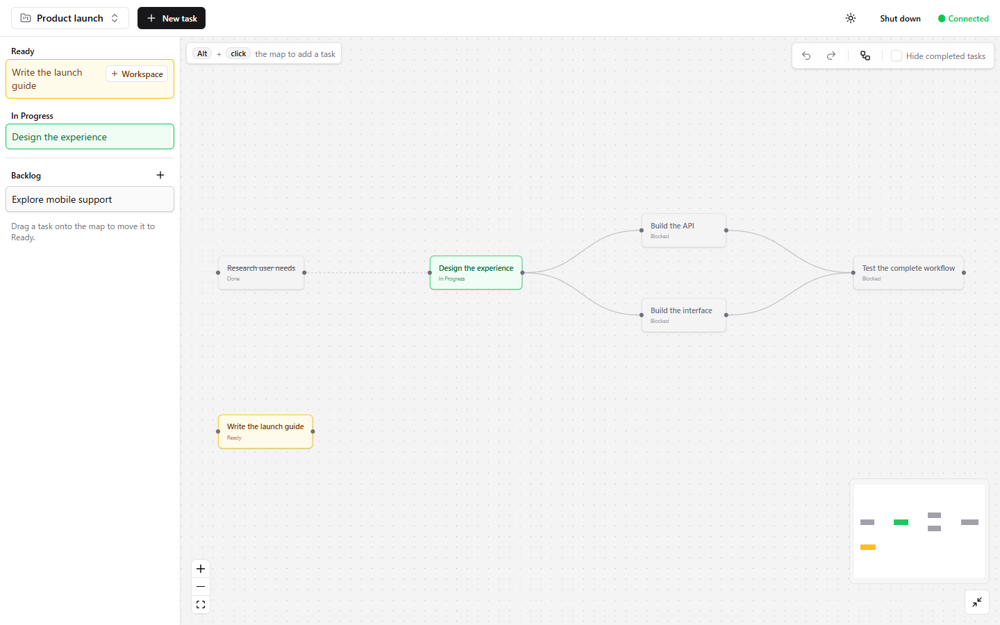

# dagdo for Orca

**See what is blocking your work. Pick the next task with confidence.**

[](https://github.com/OsamuMikumo0704/dagdo-for-orca/actions/workflows/ci.yml)
[](https://github.com/OsamuMikumo0704/dagdo-for-orca/actions/workflows/security.yml)
[](LICENSE)

English | [日本語](docs/README.ja.md) | [简体中文](docs/README.zh-CN.md) | [Español](docs/README.es.md)

A local task manager that turns dependencies into an interactive graph. Plan a
project in your browser, find tasks that are ready to start, and let scripts or
coding agents work with the same data through a structured CLI.
**No account, API key or cloud task service required.** Orca integration is optional.



## Why use it?

- **Dependencies you can see.** Connect tasks, reveal blockers and reject dependency cycles.
- **A clear next step.** The actionable list and the next command show unblocked Ready and In Progress tasks.
- **Browser and CLI together.** Task edits update live across tabs and agents. JSON output supports automation.
- **Room to plan.** Separate projects, Backlog, notes, tree and mind-map layouts, light and dark themes.
- **Recoverable edits.** Shared Undo/Redo for tasks, connections and movement; locked writes and rotating local backups.
- **Optional Orca workspaces.** Create, open and track an independent Git workspace for a Ready task.
- **Local files you control.** Human-readable JSON, source separate from task data, and no built-in cloud task sync.

Use it for software roadmaps, research or any workflow where one task unlocks
another. The interface is English; task names and notes support Unicode.

## Download and setup

Runs from source on **Windows, macOS and Linux** with [Bun](https://bun.sh/docs/installation)
**1.4.4 or newer**. Git is needed to clone/update and to use linked worktrees;
source ZIP downloads also work without Git metadata. Linux desktop auto-open uses
xdg-open (xdg-utils); headless users can skip auto-open.

[Download source ZIP](https://github.com/OsamuMikumo0704/dagdo-for-orca/archive/refs/heads/main.zip)
· [Browse source](https://github.com/OsamuMikumo0704/dagdo-for-orca)
· [Report a bug](https://github.com/OsamuMikumo0704/dagdo-for-orca/issues/new/choose)

There are no packaged desktop installers, Homebrew formula or npm release for
this fork. Do not install the upstream npm package expecting this fork's features.

### 1. Get the source

The same commands work in PowerShell, Bash and Zsh. Keeping the clone inside an
app folder gives source and mutable data separate directories:

~~~sh
git clone https://github.com/OsamuMikumo0704/dagdo-for-orca.git dagdo/app
cd dagdo/app
bun install --frozen-lockfile
bun run build
bun run start
~~~

For a ZIP download, extract it to your own dagdo/app folder and run the last
three commands there. Keep each installation in its own parent folder: main
launchers share that parent's data directory.

### 2. Open the map

The launcher creates a backup and opens **http://localhost:3737**. Keep the terminal
open. Stop with **Ctrl+C** or the browser's **Shut down** action. For a machine
without a desktop, run:

~~~sh
bun run start --no-open
# Or choose a different port:
bun run start --port 3837
~~~

A main-worktree port conflict is an error. The server binds only to loopback;
this is a single-user application, not a public hosted service.
Windows also has optional background launchers (PowerShell 5.1 or 7):

~~~powershell
.\scripts\start.ps1
.\scripts\stop.ps1
~~~

If scripts are blocked, use a process-only execution-policy override described in
[Windows operations](docs/windows-local.md). Closing a browser tab does not stop
a background server.

### 3. Try your first dependency

~~~sh
bun run scripts/dagdo.ts add 'Design database schema' --json
bun run scripts/dagdo.ts add 'Implement API' --after <design-id> --json
bun run scripts/dagdo.ts next --json
bun run scripts/dagdo.ts done <design-id> --json
~~~

Replace the placeholder with the ID from the first command. Completing the design
unblocks implementation. With multiple projects, add --project followed by the ID
to task commands; the projects command lists IDs.

## Use the browser

Create tasks, double-click to edit, drag between connection handles to add a
dependency, and use the project picker to organize separate maps. Backlog holds
ideas until you drag them onto the map. In the task list, single-click centers a
task and double-click opens its details.

Hold **Space** and drag to pan. **Alt/Option + click** creates a task on empty
canvas. Select items and press **Delete/Backspace** to remove them. Use the map's
**Undo/Redo** arrows or **Ctrl/Cmd+Z** and **Ctrl/Cmd+Shift+Z** for shared history.
History retains up to 100 operations per project while the server runs, including
observed CLI edits; restarting clears it. Text fields keep normal text undo.

## Use the CLI

Run commands through `bun run scripts/dagdo.ts` so they use the same local data as the browser. The CLI also works while the server is stopped. All `.ps1` launchers support Windows PowerShell 5.1 and PowerShell 7. `bun run scripts/dagdo.ts <command>` applies the same settings and works from any shell, including Git Bash.

```sh
bun run scripts/dagdo.ts add 'Design database schema' --progress ready
bun run scripts/dagdo.ts add 'Implement API' --after '<design-id>'
bun run scripts/dagdo.ts next
bun run scripts/dagdo.ts done '<design-id>'
bun run scripts/dagdo.ts graph
```

Replace `<design-id>` with the ID printed by `add`. IDs have six hexadecimal characters; any unique prefix is accepted.

The table below lists command arguments to pass after `bun run scripts/dagdo.ts`.

| Command | Purpose |
| --- | --- |
| `add <title>` | Create a task; supports `--progress backlog\|ready\|in_progress`, repeatable `--after` and `--before`, and `--note` or `--note-file`. |
| `done <id> [<id2> ...]` | Complete tasks and report newly unblocked tasks. Blocked tasks cannot be completed; finish prerequisites first. |
| `reopen <id> [<id2> ...]` | Undo completion and report tasks that become blocked again. |
| `next [--limit <n>]` | List unblocked Ready and In Progress tasks, sorted by creation time. |
| `list [--all] [--done]` | List tasks; `ls` is an alias. |
| `show <id>` | Show a task's details, notes, dependencies and workspace. |
| `link <id> --before <other>` | Make `<other>` depend on `<id>`; `--after` reverses the direction. |
| `unlink <id> <other>` | Remove a dependency in either direction. |
| `edit <id>` | Change `--title`, `--progress`, `--note`, `--note-file`, or `--clear-note`. |
| `rm <id> [<id2> ...] [--force]` | Remove tasks and their dependencies together; `remove` is an alias. `--force` is required when other tasks depend on them. |
| `undo`, `redo` | Step through the browser's shared map history. Requires the running UI server. |
| `projects [add\|rename\|rm]` | List, create, rename or delete projects. Deleting a project with tasks requires `--force`. |
| `workspace <action>` | Find, complete, create, open, inspect, recover or unlink Orca workspaces. See [Orca workspace integration](#orca-workspace-integration). |
| `graph [--all]` | Show an ASCII graph. |
| `graph --json` | Print tasks and dependencies as JSON. |
| `graph --mermaid` | Print Mermaid graph syntax. |
| `graph --png <file> [--dot]` | Export PNG or SVG with Mermaid, or Graphviz when `--dot` is set. |
| `view` | Render the full graph as SVG and open it in a browser. |
| `ui [--port <n>] [--no-open]` | Start an interactive server; prefer `bun run start` for daily operation. |
| `status` | Show total, completed, Backlog, Ready, In Progress, and blocked task counts. |
| `help` | Show the full command reference. |
| `--version` | Print the application version. |
| `sync`, `upgrade` | Retained for upstream compatibility; disabled by the local launchers. |

Task, project, workspace, `undo` and `redo` commands accept `--json`. Results go to stdout; failures exit with code 1 and print `{"error","message"}` to stderr. Use `--note-file <path>` for multi-line notes. The `.ps1` launcher preserves double quotes in arguments; when calling Bun directly from Windows PowerShell 5.1, use `--note-file` for quoted notes because its native argument handling removes double quotes.

Progress states are `backlog`, `ready` (default), `in_progress`. Blocked and Done are derived from dependencies and completion. Dependency changes and completion preserve progress. Existing tasks without progress default to Ready; legacy priority is discarded on normal save. Notes are plain text with a limit of 2,000 characters. Image export uses optional rendering dependencies; Mermaid rendering also needs a Playwright browser installation. ASCII and Mermaid text output need no browser renderer.

## Data, backups and updates

~~~text
dagdo/
  app/       Source code (this repository)
  data/      Private projects, tasks and dependencies
  backups/   Last 30 completed backup generations
  local/     Windows background runtime and logs
~~~

Launchers derive paths from the source directory. Process-local DAGDO_DATA_DIR and
DAGDO_BACKUP_DIR override data/backup paths; do not set them globally. Linked Git
worktrees use their own ignored .dagdo-dev/ with fictional tasks and ports from 3738.
Always use the launcher so the CLI and browser use the same store.

~~~sh
bun run backup
# Stop the UI and all agents that write tasks before restoring:
bun run restore /absolute/path/to/dagdo/backups/GENERATION --writes-stopped
~~~

Do not edit data.json directly. Backups contain private tasks and workspace
information too. To update, stop the UI and agent writers, back up, then run:

~~~sh
git pull --ff-only
bun install --frozen-lockfile
bun run check
bun run start
~~~

ZIP users replace only source files after backing up. Copy backups to separate
storage for protection against disk loss. Supported launchers disable legacy
upstream npm updates, upgrade, sync and alias prompts; update through source.

## Agents and development

Run the optional skill installer once from the main checkout:

~~~sh
bun run scripts/install-skill.ts
~~~

It links [the agent skill](skills/dagdo/SKILL.md) into ~/.agents/skills/dagdo and
~/.claude/skills/dagdo. Existing unrelated folders are never overwritten. The skill
covers every browser mutation, workspace recovery and structured JSON output.

Run **bun run check** for tests, backend/frontend types and the UI build with
temporary task data. Windows contributors should use **scripts/check.ps1** to
include PowerShell launcher validation. CI runs Windows, macOS and Linux checks.

- [Cross-platform operations and troubleshooting](docs/operations.md)
- [Detailed Japanese usage guide](docs/usage-ja.md)
- [Windows background operations](docs/windows-local.md)
- [Architecture and change guide](docs/architecture.md)
- [Contributing and translations](CONTRIBUTING.md) · [Community conduct](CODE_OF_CONDUCT.md)
- [Security and private reports](SECURITY.md)

## License and credits

MIT, with the original copyright preserved in [LICENSE](LICENSE).
Derived from [Rory Cai's dagdo](https://github.com/Coiggahou2002/dagdo) and maintained
independently. See [third-party notices](THIRD_PARTY_NOTICES.md). Orca is an
optional external integration, not required for normal task management.

## Orca workspace integration

Ready tasks offer **Create workspace** in the actionable list and task details.
Choose a ready local Git project registered in Orca, the workspace name and base
branch. Advanced settings control the Git branch name and setup hooks. Creation
uses an independent workspace, saves its stable Orca identity and changes the task
to In Progress. Orca opens the new workspace; start your agent there manually.
Each task has one linked workspace. Click its name in the actionable list to open
it in Orca. Task details show its branch/path, **Open in Orca**. Agent completion updates DAGDO; workspace archival
and Orca's own status remain manual operations.

From a workspace or its subdirectories, use the absolute DAGDO launcher:

```powershell
& 'C:\path\to\dagdo\app\scripts\dagdo.ps1' workspace task --json
& 'C:\path\to\dagdo\app\scripts\dagdo.ps1' workspace done --json
```

Both commands accept `--workspace <identity-or-full-id>` or `--cwd <path>`, and an
optional `--project <ID>`. Without a project they search every project in the
current data store. Explicit workspace lookup works with Orca stopped; automatic
directory lookup needs Orca running. `done` checks dependencies and safely accepts
repeat completion without changing the original completion time. JSON errors go
to stderr with `error` and `message`; failures exit nonzero. These commands also
work from any shell with `bun run '/path/to/dagdo/app/scripts/dagdo.ts'`.

The browser's workspace actions are also available to agents. They use the selected
project and need `--project <ID>` when several exist:

| Command | Browser action |
| --- | --- |
| `workspace projects`, `workspace refs --orca-project <setup-id> [--query <text>]` | List Orca projects and search branches. |
| `workspace create --task <id> --orca-project <setup-id> [--name] [--base] [--branch] [--hooks inherit\|run\|skip] [--open]` | **Create workspace**. |
| `workspace status --task <id>` | Linked workspace details. |
| `workspace open --task <id>` | **Open in Orca**. |
| `workspace start` | **Start Orca**. |
| `workspace reconcile --task <id> [--workspace <selector> \| --reset]` | **Check creation**, **Link existing workspace**, **Reset failed creation**. |
| `workspace unlink --task <id>` | **Unlink and return to Ready**. |

Orca CLI resolution uses process-local `DAGDO_ORCA_COMMAND`, then
`ORCA_CLI_COMMAND`, PATH, then the standard Windows install location. The command
setting is an executable path, without shell arguments. Remote Orca environment
selectors are excluded from this local integration.

If creation has an unknown result, use **Check creation** before trying again.
You can identify an existing workspace explicitly, or reset the reservation after
confirming the old operation has stopped and created no workspace. Resetting an
unknown operation can produce duplicates. Deletion and status edits are blocked
while a creation reservation exists; unrelated tasks remain editable. Missing or
archived linked workspaces can be explicitly unlinked and the task returned to
Ready, including reopening a completed task. No Orca workspace is deleted by this
operation.

### Backlog

Backlog tasks belong to a project and appear only as rows below the actionable task list. Use **Add backlog task**, enter a title in the inline form and press **Add** or Enter (Cancel or Escape discards it). Alternatively use `add <title> --progress backlog` to register one. Click a row to edit it. Drag it onto the map, or use `edit <id> --progress ready`, to move the same task to Ready. Dragging preserves its ID, notes and creation date.

Use `edit <id> --progress backlog --clear-dependencies` to return a connected task to Backlog and remove every incoming and outgoing dependency. The browser asks for confirmation before removing connections. Without connections, `--clear-dependencies` is optional; it is valid only with `--progress backlog`. Undo restores the status and connections together; moving onto the map and its placement also share one undo operation.

Backlog tasks cannot be completed or connected until moved out of Backlog. Reopen completed tasks before moving them to Backlog. `list` and `show` include Backlog, `next` excludes it, and graph exports exclude it even with `--all`. `status --json` includes a `backlog` count; `active` still counts all unfinished tasks.
